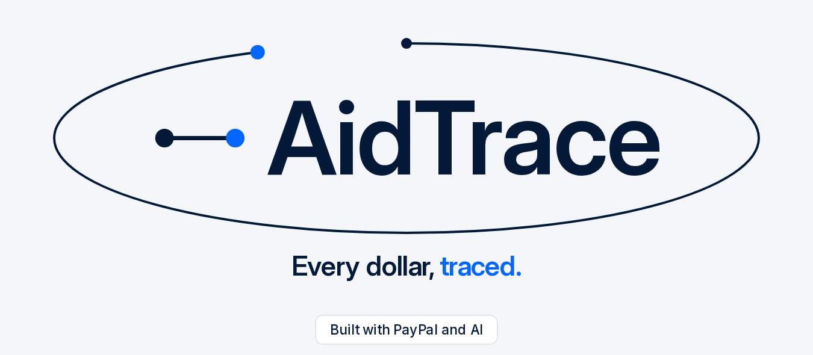
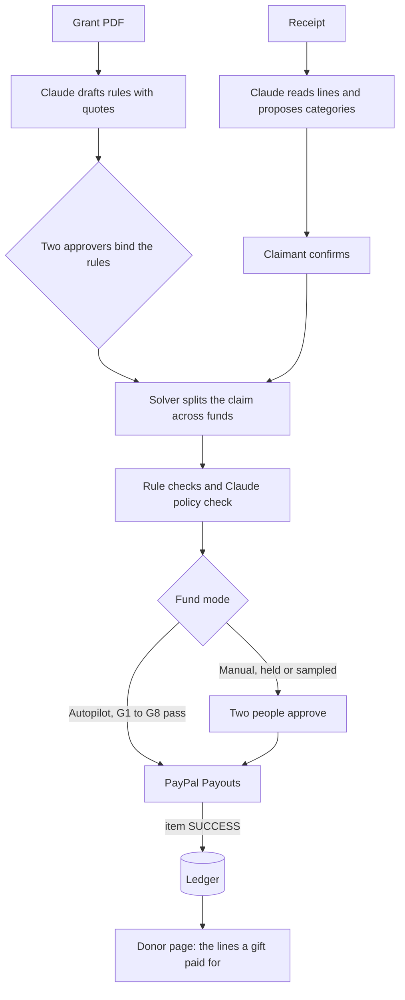
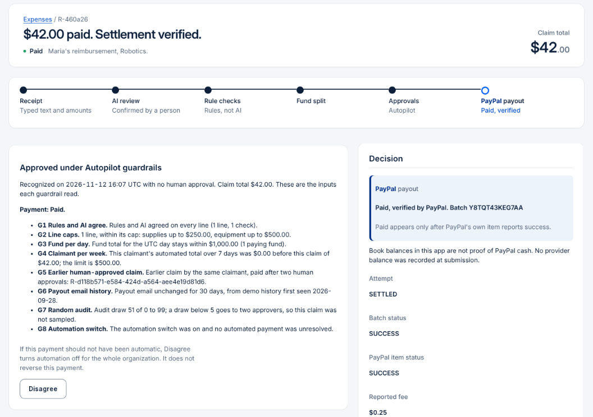
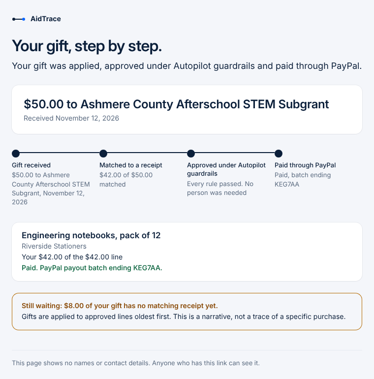
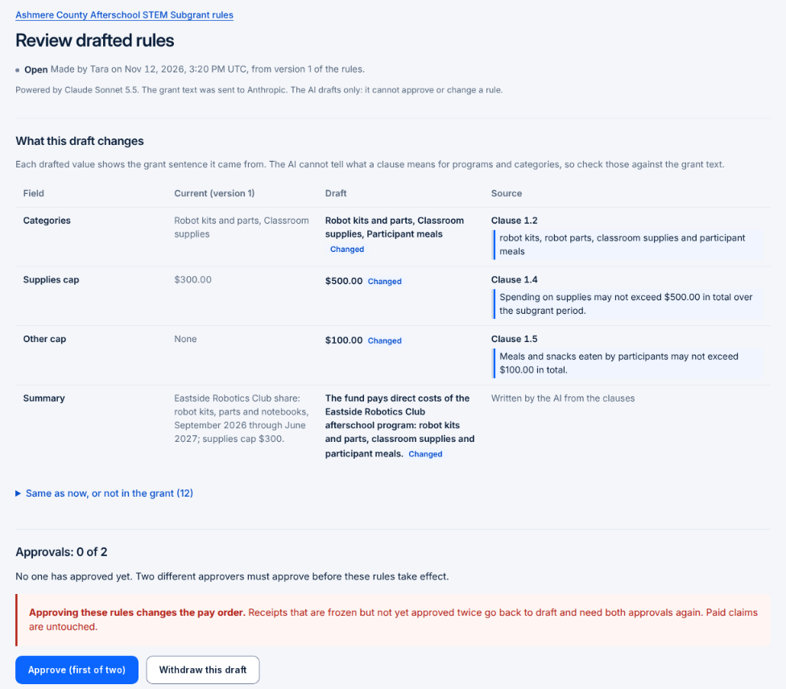
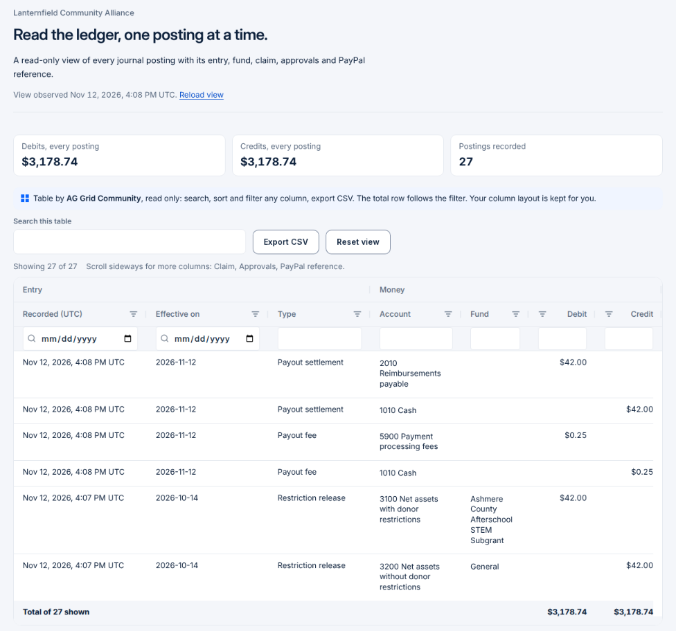

<p align="center">
  
</p>

<p align="center">
  Claude turns a grant PDF into rules two people approve. Once they turn on Autopilot, small clean claims pay through PayPal with no approval click, and donors see the lines their gift was applied to.
</p>

<p align="center">
  <a href="https://nextjs.org/"></a>
  <a href="https://react.dev/"></a>
  <a href="https://www.typescriptlang.org/"></a>
  <a href="https://www.postgresql.org/"></a>
  <a href="https://orm.drizzle.team/"></a>
  <a href="https://www.docker.com/"></a>
  <br>
  <a href="https://developer.paypal.com/"></a>
  <a href="https://docs.anthropic.com/"></a>
  <a href="https://www.ag-grid.com/"></a>
  <a href="https://vitest.dev/"></a>
  <a href="https://playwright.dev/"></a>
  <a href="LICENSE"></a>
</p>

<p align="center">
  <a href="VIDEO_URL_TODO"><b>Demo video</b></a> ·
  <a href="TEASER_URL_TODO"><b>Teaser</b></a> ·
  <a href="https://98-89-192-170.sslip.io/"><b>Live demo</b></a> ·
  <a href="DEVPOST_URL_TODO"><b>Devpost</b></a>
</p>

All payments are PayPal sandbox payments. The nonprofit, grants and receipts are invented.

## Why

Donors ask a fair question: "What did my gift pay for?" The usual answer comes once a year at a
board meeting, and it is rough: "here is roughly where the funds went."

Behind that answer sits work nobody sees. Every restricted grant has its own caps, dates and
exclusions. A treasurer retypes those rules, matches each receipt line to a fund, chases a second
signature, sends the reimbursement and later proves to the funder that no restricted dollar paid
for an ineligible line. Paying from the wrong fund quietly burns unrestricted money.

AidTrace puts that loop in one place. AI does the reading. Code does the math. People keep the
authority. PayPal moves the money. The donor gets a specific answer.

## What it does

The full loop in the sandbox: a donor gives $50 to the Ashmere STEM fund through PayPal Checkout.
A claimant submits a $42 receipt for notebooks. Claude checks it against the grant, the solver
funds it from Ashmere alone, eight guardrails pass and PayPal Payouts sends the money. The claim
reads Paid only after PayPal reports the payout item as successful. The donor's private link then
shows the notebooks line their gift went to. A claim that fails any guardrail goes to two people.

1. **Grant PDF to rules.** Claude Sonnet 5.5 drafts caps, dates and categories, each beside the
   exact quote it came from, and code checks every quote. Anything the grant does not support
   stays empty. Two different approvers bind the draft.
2. **Receipt to categories.** Claude Haiku 5.5 reads the receipt photo, code checks the
   arithmetic to the cent, Claude proposes a category per line with a quote and the claimant
   confirms.
3. **Funding split.** A min-cost flow solver in integer cents applies each fund's restrictions
   and uses as little unrestricted money as the rules allow. No model decides the split.
4. **Checks before money moves.** Rule checks and a Claude policy check with clause citations
   can hold a claim. A model answer alone never pays one.
5. **Three fund modes.** Manual: two people approve every claim. Assisted: bulk approval of clean
   claims. Autopilot: a small clean claim pays itself under eight guardrails. Turning automation
   on takes two approvers.
6. **PayPal on both sides.** Checkout (Orders v2) for gifts, Payouts for reimbursements, and
   verified webhooks.
7. **Books in AG Grid Community.** Read-only ledger, donations and approver queue views, plus a
   funder report that ties out to the books.



## Screenshots

From a funded PayPal sandbox rehearsal on November 12, 2026.

**A $42.00 claim paid under Autopilot**, with the eight guardrail inputs and the PayPal status.



<table>
  <tr>
    <td width="50%"><b>The donor page.</b> "Your gift, step by step."<br></td>
    <td width="50%"><b>Grant to rules.</b> Each drafted value beside its clause, waiting for two approvers.<br></td>
  </tr>
</table>

**The ledger in AG Grid Community.** Read-only, filterable, with a total row that follows the filter.



## Money rules

1. All money is integer cents, from the database to the PayPal adapter.
2. Only `src/paypal/adapter.ts` calls PayPal. Only the ledger module writes journal entries.
3. Each approval binds a SHA-256 hash of the exact terms the approver saw. A changed term needs
   new approvals.
4. A Manual claim needs two different approvers, neither of them the claimant.
5. Paid means PayPal reported the payout item as SUCCESS. Settlement and the PayPal fee post
   exactly once, through refreshes and replayed webhooks.
6. A payout with an uncertain outcome stays UNKNOWN. Only a person's retry authorization can
   retry it, so a network failure cannot become a second payment.
7. Autopilot pays only when all eight guardrails pass, including line caps, daily and weekly
   limits, a 5 percent random audit and a kill switch. See
   [docs/ARCHITECTURE.md](docs/ARCHITECTURE.md).

## AI and its limits

Models: Claude Sonnet 5.5 drafts fund rules. Claude Haiku 5.5 reads receipts, proposes
categories and runs the policy check.

1. Every Claude call has no tools, a closed JSON schema and validation in code.
2. The AI suggests categories. The claimant confirms them.
3. The AI drafts fund rules. Two different people bind them. The model never writes a binding
   rule.
4. The AI never freezes a claim, approves it, allocates funds or pays.
5. A quote that matches the source does not prove a value is right. A person checks it.
6. One running app sends at most 60 Claude requests, then turns the AI off until it restarts.
7. Every AI screen names the model that answered. Without a key, the manual path works end to end.

| Evaluation | Result | Limit |
|---|---|---|
| Rules drafter, four agreements | 69 of 69 determinate fields right, 0 fabricated | Invented agreements |
| Policy check, 840 calls | 0 of 72 risky runs cleared; at least 32 of 96 clean runs held | Synthetic receipts, labels written by Claude; a zero is a bound, not a rate |
| Receipt photo reader | 5 of 5 photos, 5 of 5 injection receipts | Ten invented images, one run each; the prompt was revised after a first run scored 4 of 5 |
| Sandbox payments | $500.00 after two approvals; a $50.00 gift; a $42.00 claim under Autopilot | One rehearsal run each |

The evaluation harnesses and their datasets are not in this repository.

## Tech stack

| Layer | Choice |
|---|---|
| App | Next.js 16, React 19, TypeScript 5.9, Node.js 22 |
| Data | PostgreSQL 16, Drizzle ORM, SQL migrations |
| Payments | PayPal Checkout (Orders v2), PayPal Payouts, verified webhooks, sandbox only |
| AI | Claude Haiku 5.5 and Claude Sonnet 5.5 through the Anthropic API (`@anthropic-ai/sdk`) |
| Grids | AG Grid Community 36.2.0 |
| PDF text | unpdf |
| Runtime | Docker Compose |
| Tests | Vitest, fast-check, Playwright |

## Try the hosted demo

Open https://98-89-192-170.sslip.io/ and choose Open workspace for any workspace from 1 to 7.
Each workspace is a private copy of the app with sample data and its own AI request limit. The
passwords for the three demo users (maria, tara and ben) come with the judging instructions,
not in this repository.

1. Sign in as maria and open Review Maria's $500 receipt. Create the draft, confirm the
   categories, continue to funding and freeze the terms.
2. Sign in as tara, open the awaiting claim and approve.
3. Sign in as ben and approve the same terms. The claim shows approved and unpaid.
4. For AI-drafted rules, sign in as tara and use Draft rules from a grant on the home page.

Hosted workspaces have no PayPal credentials, so nothing is sent to PayPal. Fund modes,
Autopilot, Checkout gifts, the donor page and the Paid state are shown in the demo video.

## Run it locally with Docker

You need Docker with Compose v2 on a Linux ARM64 or AMD64 engine, and a POSIX shell. No native
Node, pnpm, Python or Postgres. No PayPal account: local judging sessions never pay.

```sh
git clone https://github.com/pvnarp/aidtrace.git
cd aidtrace
sh scripts/aidtrace doctor
sh scripts/aidtrace setup
sh scripts/aidtrace judge-new review-one 3102
sh scripts/aidtrace judge-up review-one
```

Open http://127.0.0.1:3102/login. The launcher writes the three generated passwords to
`local/judge-sessions/review-one/session.env`. Do not share that file.

To turn the AI on, export your own key in the same shell before `judge-up`. Use
`read -rs ANTHROPIC_API_KEY` and then `export ANTHROPIC_API_KEY` so the value stays out of your
shell history. The launcher passes the key to the app container by name and never writes it to
a file. [docs/JUDGING.md](docs/JUDGING.md) covers what a session shows with and without a key,
and how to recover from common setup problems.

## Tests

```sh
sh scripts/aidtrace check
```

`check` runs the Vitest suite and the TypeScript compiler. In this repository, 2,489 tests in
134 test files pass, with 4 tests and 1 file skipped. The tests run on synthetic fixtures with a
scripted stand-in for the AI, so they are not evidence about PayPal or the Claude API. There is
no CI.

## Project structure

```text
.
├── src/
│   ├── app/          Next.js pages, routes and UI
│   ├── server/       authenticated actions, sign-in and read models
│   ├── domain/       allocation solver and decision hash
│   ├── ledger/       the only journal writer: approvals, payouts, settlement
│   ├── paypal/       the only PayPal caller
│   ├── ai/           Claude client, request cap, receipt and photo readers
│   ├── rules-draft/  grant text to drafted rules
│   ├── policy/       rule checks and the Claude policy check
│   ├── fund-modes/   Manual, Assisted, Autopilot and guardrails G1 to G8
│   ├── donation/     Checkout orders, gift attribution, donor page
│   └── analytics/    dashboard facts and funder report
├── db/               Drizzle schema, migrations, invented seed data
├── tests/            Vitest unit and integration tests
├── e2e/              Playwright browser suites
├── scripts/aidtrace  the Docker launcher
└── docs/             architecture, judging guide, licensing
```

## Limits

1. Sandbox payments only. Nothing here moves real money.
2. The nonprofit, grants and receipts are invented.
3. The 30-day payout email history behind guardrail G6 is seeded for the demo.
4. The donor link is shown once, with no recovery flow.
5. Scanned-PDF grants are not supported. The rules drafter needs a text PDF or pasted text.
6. The accounting model has not been reviewed by a nonprofit accountant, and there has been no
   pilot with a real treasurer.

## License and credits

The application is released under the [MIT License](LICENSE). Copyright (c) 2026 Pavan
Aripakula.

Dependencies and services keep their own terms. See [NOTICE](NOTICE),
[THIRD_PARTY_NOTICES.txt](THIRD_PARTY_NOTICES.txt), [docs/LICENSING.md](docs/LICENSING.md),
[docs/THIRD_PARTY_MODELS.md](docs/THIRD_PARTY_MODELS.md) and
[docs/FONT_PROVENANCE.md](docs/FONT_PROVENANCE.md). AG Grid Community is under the MIT License.
The bundled Inter font is under the SIL Open Font License.

Built solo by Pavan Aripakula for the PayPal AI hackathon. Claude Code and Codex helped write,
test and review the code under the author's direction.
