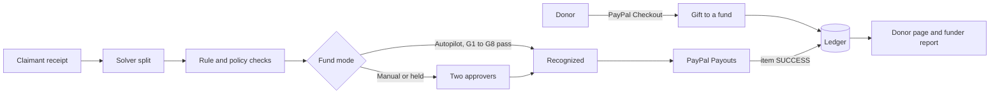

# Architecture

AidTrace is one Next.js app backed by one PostgreSQL database, run in Docker. The AI reads and
drafts. Code does the math. People hold the authority. PayPal moves the money.

## 1. Components

| Part | Where | Job |
|---|---|---|
| Web app and routes | `src/app/` | Next.js 16 pages and route handlers for claimants, approvers and donors |
| Server actions and views | `src/server/` | Authenticated actions, sign-in, rate limits and read models |
| Allocation solver | `src/domain/` | Min-cost flow in integer cents that picks the funds for each line |
| Ledger | `src/ledger/` | The only writer of journal entries; freeze, approve, recognize, payout, settlement, reconcile |
| PayPal adapter | `src/paypal/adapter.ts` | The only file that calls PayPal: OAuth, Orders v2, Payouts, status reads |
| Policy checks | `src/policy/` | Rule checks plus a Claude policy check with clause citations |
| Rules drafter | `src/rules-draft/` | Claude Sonnet 5.5 drafts fund rules from grant text, each value with its quote |
| Receipt reader | `src/ai/`, `src/receipt/` | Claude Haiku 5.5 reads receipt photos and proposes categories |
| Fund modes | `src/fund-modes/` | Manual, Assisted and Autopilot, with guardrails G1 to G8 and a kill switch |
| Donations | `src/donation/` | Checkout orders, gift attribution and the private donor page |
| Analytics | `src/analytics/` | Read-only dashboard facts and the funder report |
| Schema and seed | `db/` | Drizzle schema, SQL migrations and the invented fixture |

## 2. Money flow

1. A donor gives to a fund through PayPal Checkout (Orders v2). A guarded capture posts the gift
   to the ledger once.
2. A claimant submits a receipt. Claude proposes a category per line with a quote. The claimant
   confirms each one.
3. The solver splits the claim across funds, using as little unrestricted money as each fund's
   rules allow. No model decides the split.
4. Rule checks and the Claude policy check run. Either can hold a claim. Neither can pay one.
5. The fund mode decides who approves. Approvals bind a SHA-256 decision hash of the exact terms
   the approver saw.
6. The ledger persists the payout attempt as UNKNOWN, then the adapter calls PayPal Payouts.
7. The claim reads Paid only after PayPal reports the payout item as SUCCESS. Settlement and the
   PayPal fee post exactly once, through refreshes and replayed webhooks.
8. The donor page shows which approved receipt lines the gift was applied to.

All amounts are integer cents from the database to the adapter. The adapter formats the USD
string for PayPal.

## 3. Trust boundaries

1. **The AI has no financial tools.** Every Claude call runs with no tools, a closed JSON schema
   and validation in code. The AI suggests categories, drafts rules, reads photos and checks
   policy. It never confirms, freezes, approves, allocates or pays.
2. **One PayPal adapter.** Only `src/paypal/adapter.ts` calls PayPal. `tests/guard-pins.test.ts`
   pins that across the repository.
3. **One ledger writer.** Only the ledger module writes journal entries. Database constraints
   keep journals balanced and approved records immutable.
4. **Two approvers.** A Manual claim needs two different people, neither of them the claimant.
   AI-drafted rules bind only after two different approvers. Turning Autopilot on also takes two
   approvers.
5. **Autopilot guardrails.** A claim pays with no approval click only when all eight pass
   (`src/fund-modes/guardrails.ts`):

   | Id | Guardrail |
   |---|---|
   | G1 | Rules and AI agree on every line |
   | G2 | Line caps: supplies up to USD 250.00, equipment up to USD 500.00; any other line goes to people |
   | G3 | Fund total per UTC day stays within USD 1,000.00 |
   | G4 | Automated total per claimant over 7 days stays within USD 500.00 |
   | G5 | The claimant has an earlier claim paid after two human approvals |
   | G6 | The payout email has been unchanged for 30 days |
   | G7 | A 5 percent random audit draw sends the claim to two approvers |
   | G8 | The kill switch is on and no automated payment is unresolved |

   Any approver can press Disagree, which turns automation off for the whole organization.
6. **UNKNOWN outcomes.** A payout whose result is uncertain stays UNKNOWN. Nothing retries it
   automatically. Only a person's retry authorization can, so a network failure cannot become a
   second payment.
7. **Request cap.** One app process sends at most 60 Claude requests, then AI is off until the
   app restarts. Without a key, no request is made and the manual path still works.

## 4. Data

PostgreSQL 16 with Drizzle ORM. Migrations live in `db/migrations/`. The seed in `db/fixture.ts`
creates an invented nonprofit, Lanternfield Community Alliance, with three funds: Ashmere County
Afterschool STEM Subgrant, Tallow Creek Robot Kit Initiative and General Operating.

The accounting model (recognition and restriction release) has not been reviewed by a nonprofit
accountant.
